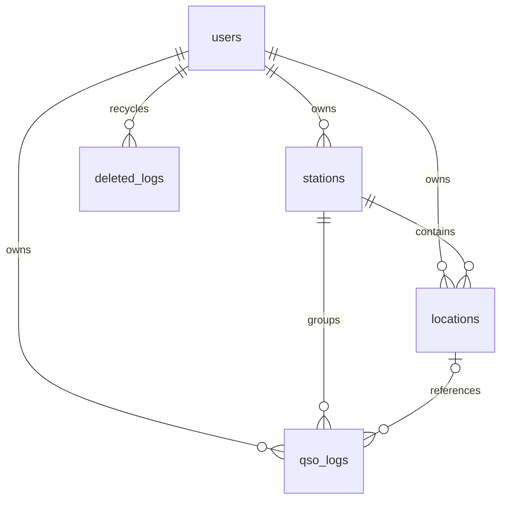

# RadioManager — 架构与实现索引

本文用于从功能定位源码。使用步骤见 [README](README.md)，详细设计见 [doc/](doc/README.md)。

## 1. 项目概述

RadioManager 以 FastAPI 和 Vue 3 管理业余无线电 QSO 日志。SQLite 用于本机数据，MySQL 用于服务器数据；ADI/ADIF 用于文件交换。地图、DX Cluster、呼号查询和计算工具共用网页界面。

数据库承担实际存储；前端没有 HTTP/本地数据库两套实现。

## 2. 技术栈

| 层 | 技术与入口 |
| --- | --- |
| 网页 | Vue 3、TypeScript、Vite、Element Plus、Pinia、Router、vue-i18n |
| 地图 | Leaflet、OpenStreetMap、SunCalc |
| 后端 | FastAPI、SQLAlchemy 2、Pydantic 2、Uvicorn |
| 存储 | SQLite / MySQL；SQL 会话表保存登录与撤销状态 |
| 身份 | PyJWT、passlib/bcrypt |
| 客户端 | Electron、Capacitor 配置；独立 Windows pywebview 启动器 |
| 部署 | Docker Compose、Nginx、Windows 本地包装脚本 |

## 3. 目录结构

| 源码位置 | 阅读目的 |
| --- | --- |
| [`backend/app/main.py`](backend/app/main.py) | 应用创建、中间件、路由、健康检查 |
| [`backend/app/config.py`](backend/app/config.py) | 环境配置与数据库选择 |
| [`backend/app/api/v1/`](backend/app/api/v1/) | REST/WebSocket 入口 |
| [`backend/app/services/`](backend/app/services/) | 业务行为和实时服务 |
| [`backend/app/models/`](backend/app/models/) / [`schemas/`](backend/app/schemas/) | 表结构与 API 字段范围 |
| [`backend/app/database/`](backend/app/database/) / [`alembic/`](backend/alembic/) | 引擎、会话与迁移 |
| [`frontend/src/router/index.ts`](frontend/src/router/index.ts) | 页面与守卫 |
| [`frontend/src/stores/`](frontend/src/stores/) / [`api/`](frontend/src/api/) | 共享状态和客户端请求 |
| [`frontend/src/views/`](frontend/src/views/) | 页面交互 |
| [`backend/release_server.py`](backend/release_server.py) | 网页与 API 同源发布 |
| [`frontend/electron/`](frontend/electron/) | 桌面壳生命周期 |

## 4. 双数据库架构

`DATABASE_MODE=sqlite` 选择 `SQLITE_URL`，`mysql` 选择 `DATABASE_URL`。两者共用 12 个 ORM 模型。SQLite 启用 WAL 和外键，MySQL 配置连接池检查。

MySQL 增加管理员路由与审计。两种模式都使用 SQL 会话认证和撤销，不依赖 Redis。切换模式不迁移数据，详见[数据库设计](doc/02_数据库设计说明.md)。

## 5. 认证与鉴权

登录 → bcrypt 校验 → 生成 access JWT → 保存 SQL 会话 → 前端保存令牌与用户。

请求 → `get_current_user` → 验证访问 JWT → 查询有效会话与用户状态 → 业务服务校验对象归属。管理员依赖另查角色。

无 refresh token。登出删除当前会话，改密、管理员重置、禁用和删除用户撤销全部会话。WebSocket 首条消息认证，URL 不传 JWT，写操作前再次校验。

## 6. 数据模型关系

台站保存呼号，位置保存网格与设备。QSO 的台站外键为 `RESTRICT`，位置外键为 `SET NULL`；这些约束仅在物理删除时触发。日常 API 使用软删除。

其余表为 `callsign_cache`、`statistics`、`log_files`、`sync_history`、`audit_logs`、`user_sessions`、`system_configs`。

## 7. 服务层职责

| 服务 | 主要职责 |
| --- | --- |
| `LogService` | QSO CRUD、自动补全、概览聚合 |
| `StationService` / `LocationService` | 台站、位置与激活操作 |
| `ImportExportService` | ADI 解析后的导入合并、分批提交与导出 |
| `DeletedLogService` | 快照、恢复与回收站清理 |
| `StatsService` | 波段、模式、DXCC 与矩阵 |
| `CallsignService` | SQL 缓存、QRZ 与离线推断 |
| `DXClusterManager` | Telnet、spot 缓冲与订阅队列 |
| `UDPListenerService` | UDP 解析与广播，保存由客户端显式触发 |
| `UserService` / `AdminService` | 用户操作与管理 |
| `SessionService` / `AuditService` | 活动追踪与审计 |
| `ConfigService` | 系统配置项存取 |
| `EmailService` / `SyncService` / `GitHubService` | 验证码与同步接口骨架 |

## 8. API 路由总览

常规模块前缀为 `/api/v1/{auth,users,logs,stations,locations,stats,callsigns,sync,shortcuts,dxcluster,map,udp}`。服务器模式另注册 `/api/v1/admin`。

日志列表和资源对象直接返回，统计返回 `{data:...}`，导出返回文件，不存在统一成功包装。请求字段、全部端点和消息见 [API 端点说明](doc/04_API端点说明.md)。

## 9. 关键数据流

### 9.1 日志创建

`logsApi.create` → `POST /logs` → `LogService.create_log` → 激活位置/UTC/DXCC 补全 → 数据库提交 → 返回日志。创建时收到纸质 QSL 会联动所有 QSL/LoTW/eQSL 标记，PATCH 不执行该联动。

### 9.2 ADIF 导入

multipart 文件 → 50 MiB 上限检查 → `ADIParser` → `(call_sign, qso_date, time_on, band, mode, freq)` 匹配 → 新增或补空合并 → 每累计 500 条新记录提交 → `log_files` 元数据。去重范围跨当前用户台站，数据库没有唯一约束。

### 9.3 统计查询

概览由 `LogService.get_stats` 聚合，可指定台站；分布、DXCC 图表和矩阵由 `StatsService` 聚合当前用户日志。这些 API 直接聚合 `qso_logs`，不读取 `statistics` 快照。

### 9.4 DX Cluster 实时推送

连接请求 → 解析激活台站呼号 → Telnet 登录 → 解析 spot → 100 条内存缓冲 → WebSocket 广播。WS 建连先逐条发送最多 100 条历史。Telnet 与浏览器 WebSocket 生命周期独立。

UDP 另走“数据报 → 字段转换 → `qso_received` 广播”；显式保存才创建日志。

## 10. 前端架构

Pinia 分为 `auth`、`logs`、`stats`、`dxcluster`。Axios 默认同源 `/api/v1`，普通超时 30 秒，导入 120 秒；健康检查为同源 `/health`，5 秒超时；文件导出用 `fetch`。

页面使用 History 路由，部署需 SPA 回退。语言为 `zh-CN/en-US`；主题为 `light/dark/system`。详情见[前端设计](doc/05_前端架构设计.md)。

## 11. Electron 安全配置

[`main.js`](frontend/electron/main.js) 使用 `contextIsolation=true`、`nodeIntegration=false`、`sandbox=true`，并申请单实例锁。`preload.js` 只暴露空的 `window.electron` 对象。

Electron 优先加载构建文件，否则加载 5173 页面；不启动 Python，也不打包后端。`RADIOMANAGER_MODE` 只用于窗口模式标签。

## 12. 设计决策备忘

| 实现选择 | 实际影响 |
| --- | --- |
| 台站与位置分离 | 同一呼号可记录多个操作地点 |
| 软删除与 JSON 快照 | 保留原 QSO，并提供 7 天恢复窗口 |
| 六字段服务层匹配 | 可识别已有 QSO 后补空；数据库没有唯一约束 |
| 实时服务使用进程内实例 | 单 worker；DX 公共 spot 共享，UDP 数据仅交付启动者 |
| 前端使用同源路径 | 代理需覆盖 API、health 与 WebSocket |
| 后台配置表与 Settings 分离 | 两套配置来源，运行参数仍从 Settings 读取 |

## 13. 常量与工具

[`dxcc.py`](backend/app/utils/dxcc.py) 负责呼号前缀推断；[`grid_utils.py`](backend/app/utils/grid_utils.py) 与前端 [`grid.ts`](frontend/src/utils/grid.ts) 处理网格；[`adi_parser.py`](backend/app/utils/adi_parser.py) 处理 ADIF 标签；[`security.py`](backend/app/utils/security.py) 处理 JWT 与密码。

前端 [`constants.ts`](frontend/src/utils/constants.ts) 保存波段与计算器数据，[`dxcc-entities.json`](frontend/src/data/dxcc-entities.json) 保存实体名称。

## 14. 中间件执行顺序

普通 HTTP 请求：`RateLimit → Logging → ErrorHandler → CORS → 路由`。认证是路由依赖。限流为单进程内存，普通桶 100 次/60 秒，敏感认证路径共用 5 次/60 秒。

## 15. 已知限制 / TODO

- GitHub 自动同步与邮件通知暂未实现。
- Electron 和 Android 包只包含前端，Python 后端需另行部署。
- ADI 导出只包含支持的字段，不作为完整数据库备份。
- WAZ 统计未完成。

回收站优先恢复原记录，清空只删除快照。部署与备份见[部署文档](doc/README.md)，流程见[系统架构图](doc/11_系统架构图.md)。
