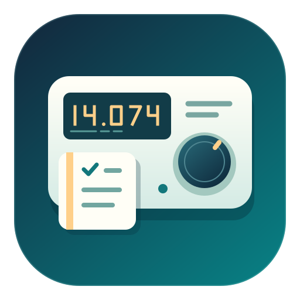

<div align="center">



# RadioManager

**业余无线电 QSO 日志管理工具**

导入 ADI / ADIF，按台站整理 QSO，查看 DXCC、波段统计与梅登网格地图。

[](https://github.com/NanamiKite/radioManger/releases/latest) [](https://github.com/NanamiKite/radioManger/releases/latest)

[下载应用](https://github.com/NanamiKite/radioManger/releases/latest) · [开始使用](#开始使用) · [文档](#文档) · [反馈问题](https://github.com/NanamiKite/radioManger/issues)

</div>

个人使用时，前后端在本机运行，日志保存在 SQLite；多人访问时，可在局域网或云服务器部署 MySQL 后端，通过浏览器使用。

按台站和操作位置保存呼号、网格、电台与天线信息，随时新建、编辑或筛选 QSO。已有日志可通过 ADI / ADIF 导入，整理后导出为 ADI；误删的日志在 7 天内可从回收站恢复。可实时接收 WSJT-X / N1MM 的 UDP 广播并在页面显示。

用波段、模式和 DXCC 统计回看通联，在梅登网格地图上查看分布。呼号查询、DX Cluster 实时 spot，以及频率/波长、SWR 和天线计算工具用于辅助操作。界面提供中文、英文和浅色 / 深色主题。

## 开始使用

### Windows 本地包

1. 从 [Releases](https://github.com/NanamiKite/radioManger/releases/latest) 下载 Windows 64 位 ZIP 包。
2. 解压到本机目录，运行 `start.bat`。
3. 在浏览器打开 <http://localhost:8000>。

发布包不会随 `main` 分支更新，使用时以对应发布说明为准。升级已有数据库前先[备份并阅读迁移说明](doc/10_初始化备份与常见问题.md)。

### 从源码运行

准备 Python 3.12、Node.js 22 和 npm。本地开发使用 SQLite，无需安装 MySQL。

<details>
<summary><b>本地开发启动（Bash）</b></summary>

先按[配置说明](doc/07_本地部署.md#12-配置与脚本启动)创建 `backend/.env`，设置 SQLite 路径和随机 JWT 密钥；已有配置不要覆盖。然后在项目根目录运行：

```bash
./start-local.sh
```

脚本准备 Python 虚拟环境与前端依赖，执行数据库迁移，再启动 FastAPI 和 Vite。浏览器打开 <http://localhost:5173>，按 `Ctrl+C` 停止服务。

手动启动与环境变量清单见[本地部署指南](doc/07_本地部署.md)；Windows 源码启动见 [PowerShell 命令](doc/09_Windows与Android部署.md#1-windows-源码本地运行)。

</details>

多人访问或服务器部署使用 MySQL，配置与 Docker Compose 命令见[服务器部署指南](doc/08_服务器部署.md)。

**第一份日志**：注册或登录账户，创建台站和操作位置，再新建日志或导入 ADI / ADIF。第一个位置会自动激活；未指定台站时，新日志和导入操作使用激活位置所属的台站。

## 文档

| 我想…… | 从这里开始 |
| --- | --- |
| 了解功能和整体结构 | [项目总览](doc/01_项目总览.md) |
| 看整体架构与流程图 | [系统架构图](doc/11_系统架构图.md) |
| 从功能定位源码 | [源码导航](PROJECT.md) |
| 调用 API | [通用规范](doc/03_API通用规范.md) · [端点说明](doc/04_API端点说明.md) |
| 修改前后端 | [前端架构](doc/05_前端架构设计.md) · [后端架构](doc/06_后端架构设计.md) |
| 改表结构或排查数据问题 | [数据库设计](doc/02_数据库设计说明.md) |
| 多人访问或服务器部署 | [服务器部署](doc/08_服务器部署.md) |
| 备份、恢复与常见问题 | [初始化与备份](doc/10_初始化备份与常见问题.md) |
| 打包桌面窗口或 Android 客户端 | [客户端部署与打包](doc/09_Windows与Android部署.md) |
| 运行测试或了解 CI | [测试设计与验收](doc/12_测试设计与验收.md) |

各篇文档的适用时机见[文档索引](doc/README.md)。

## 已知限制

- 地图底图、QRZ.com 和 DX Cluster 需要联网；日志读写使用本机或自己部署的数据库。
- TODO：GitHub 自动同步与邮件通知暂未实现。ADI 导出不含完整数据库字段与关系，不能替代[数据库备份](doc/10_初始化备份与常见问题.md#2-备份与恢复)。
- Electron 仅打包前端，Android 容器也不包含 Python 后端；使用前需另行部署后端并配置请求入口，见[客户端部署与打包](doc/09_Windows与Android部署.md)。

