# 系统架构图

图中实线表示已接通的数据路径。GitHub 文件同步和邮件发送没有接入业务链路，未画为可用外部服务。字段见[数据库设计](02_数据库设计说明.md)，端点见[API 端点说明](04_API端点说明.md)，部署步骤见[本地部署](07_本地部署.md)与[服务器部署](08_服务器部署.md)。

## 1. 整体系统架构

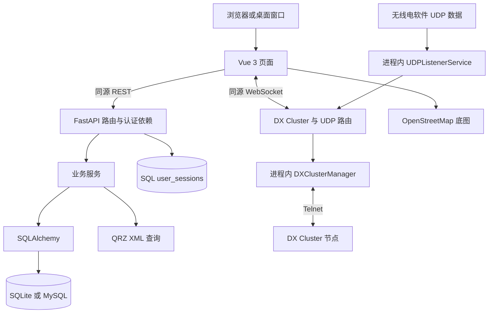

呼号缓存和登录会话位于 SQL 数据库。Telnet 与 UDP 各保留一个进程内实例；公开 spot 可共享，UDP 数据只交付启动者。

## 2. 三种部署结构

### 2.1 纯本地部署（SQLite）

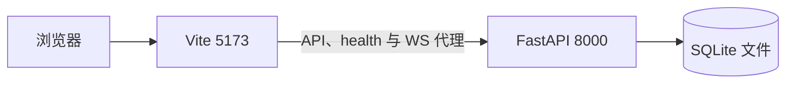

本地发布包另由 `release_server.py` 在 8000 端口同时提供静态网页和 API，不需要 Vite。pywebview 通过本机 HTTP URL 加载页面；Electron 配置本身不提供 Python 后端。

### 2.2 局域网部署（Docker + MySQL）

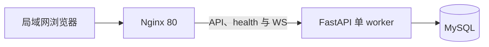

Nginx 直接提供构建后的前端，已代理 `/health`。Compose 仅发布网页 80 端口，MySQL 与后端不对外发布端口。

### 2.3 云服务器部署

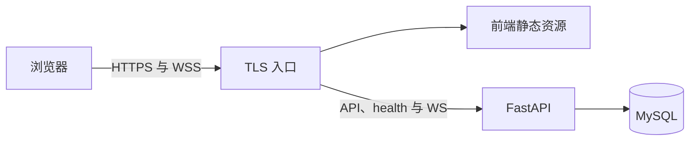

TLS 由部署方配置；数据库和缓存不需要直接向浏览器暴露。

## 3. 前端架构

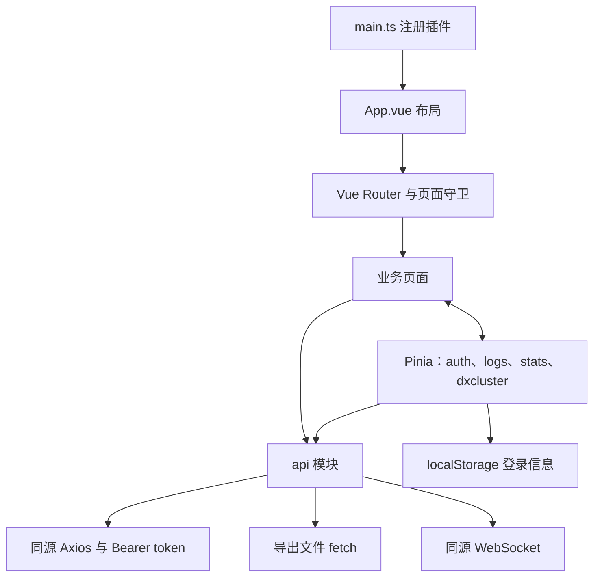

语言和主题也有本地偏好存储。页面守卫用于导航，后端仍负责实际认证。

## 4. 后端架构

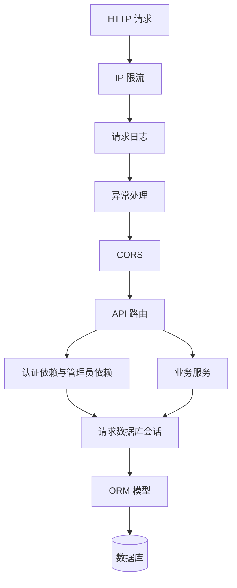

这是普通 HTTP 请求路径。WebSocket 使用各端点独立的连接认证逻辑，不经过相同的 HTTP 中间件链。

## 5. 数据库架构

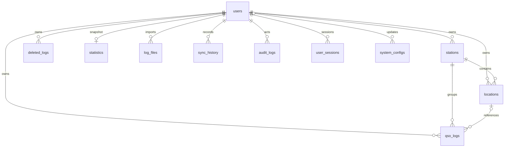

`callsign_cache` 为独立共享表。`deleted_logs.log_id` 保存原 QSO ID，但没有外键约束。审计、会话和系统配置的用户外键不统一使用 CASCADE。

## 6. 台站—位置—日志关系

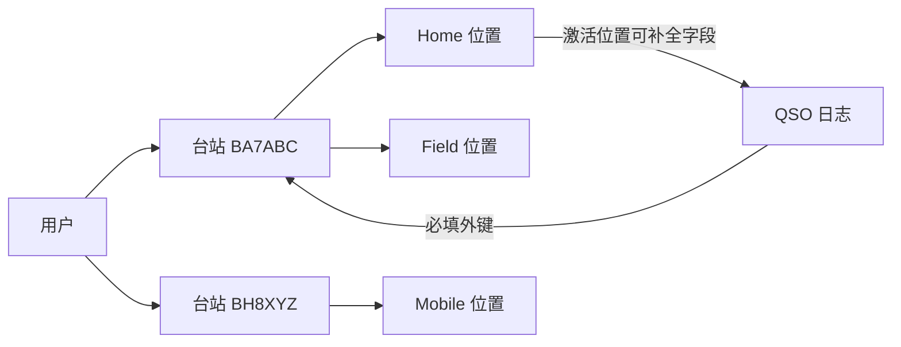

台站保存呼号，位置保存本台网格和设备。日志可保留自己的 `my_gridsquare`；导出按位置筛选时使用本网格前 4 位，不等同于日志位置外键。

## 7. 位置激活流程

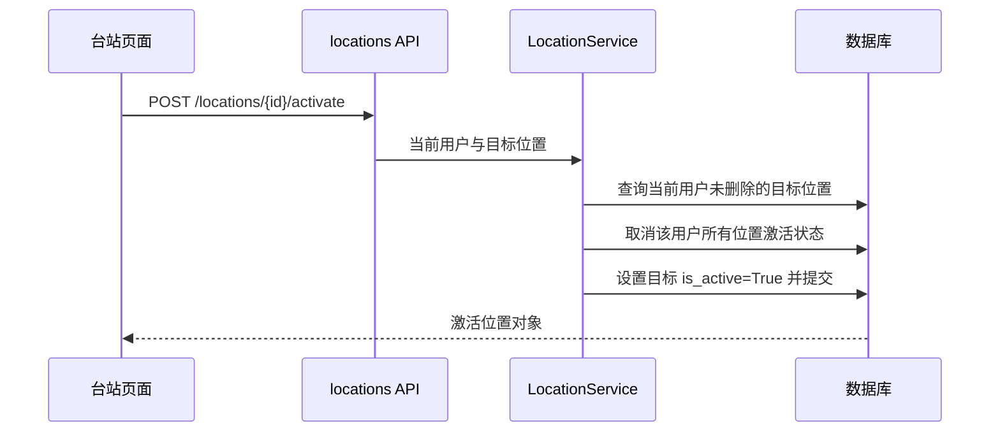

首个位置在创建时自动激活。互斥规则由服务执行，没有数据库唯一约束。

## 8. 日志导入导出流程

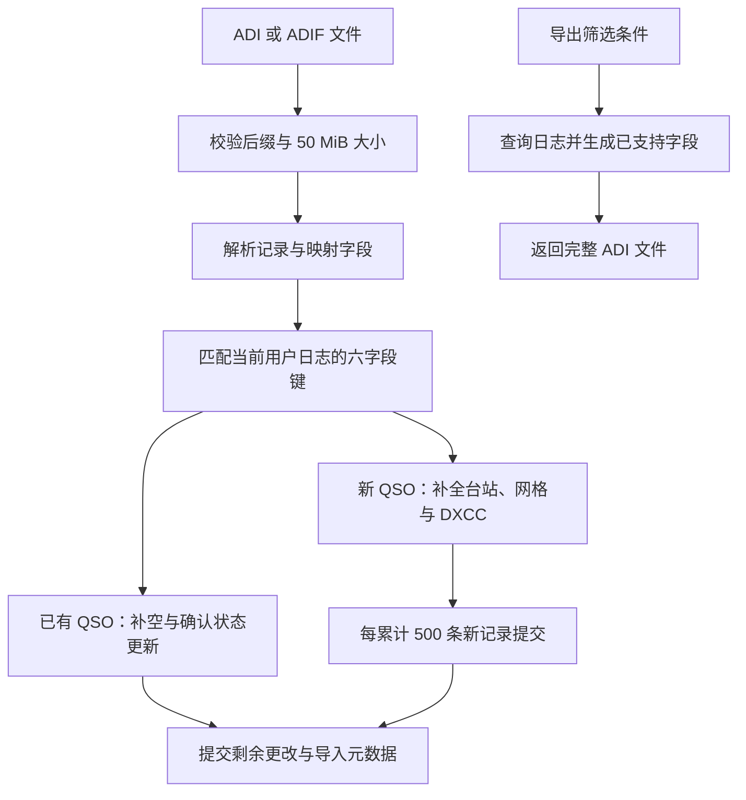

去重键为呼号、日期、开始时间、波段、模式、频率。导入按批提交；导出不包含所有数据库字段，因此文件往返不是无损备份。

## 9. 认证授权流程

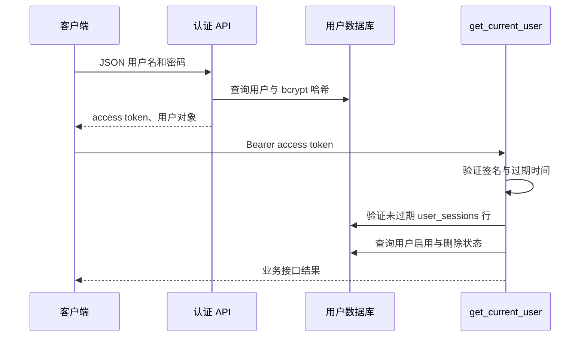

两种模式都使用 SQL 会话认证。没有刷新令牌；登出删除当前会话，密码变更及禁用删除全部会话。

## 10. 仪表板时钟与统计

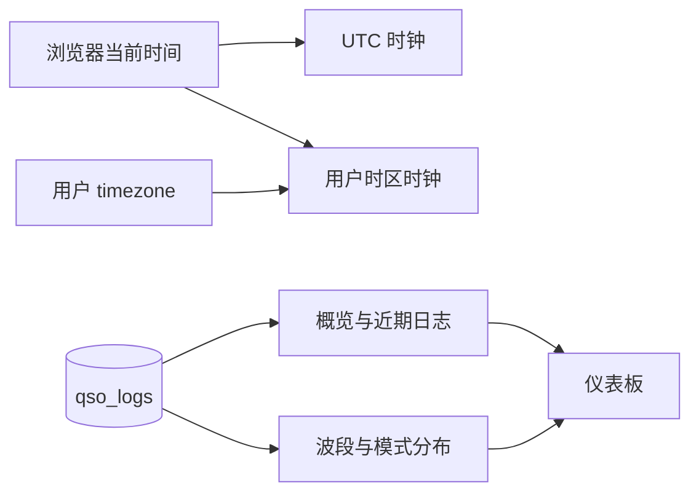

概览可按台站筛选，分布统计为当前用户全量。比赛日历来自页面内置数据。

## 11. 时区同步流程

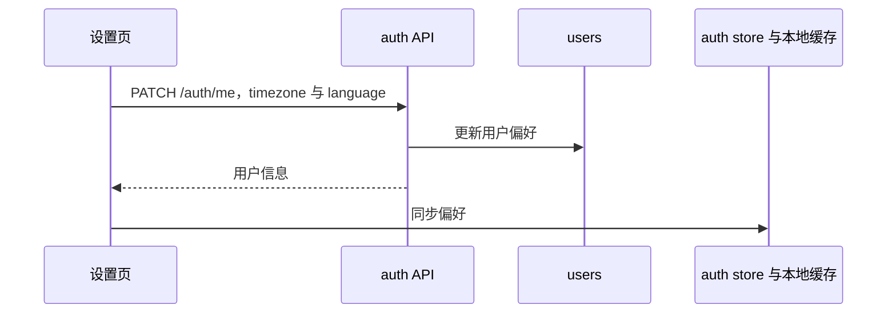

时区用于显示，不修改已有 QSO 的 UTC 日期和时间。语言还通过本地 locale 即时切换。

## 12. DX Cluster 实时 Spot 架构

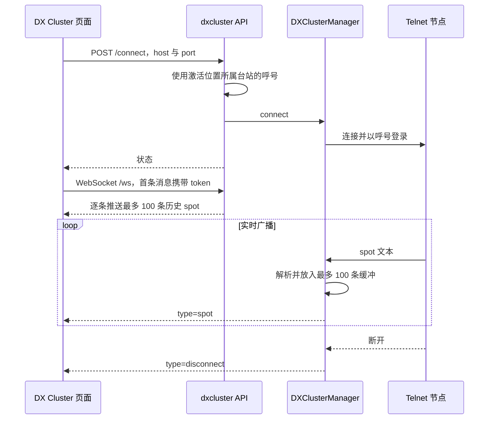

Telnet 不自动重连，前端 WebSocket 重连只恢复消息通道。MySQL 模式仅管理员能切换、断开共享节点；连接目标须在预设或服务端配置列表中。

## 13. 回收站流程

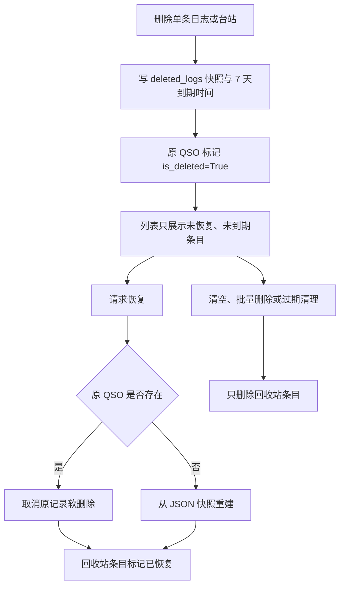

恢复日志不自动恢复台站和位置。过期条目没有后台定时任务清理；部分回收站操作会触发清理函数。

## 14. 文字版架构图

```text
页面 / Pinia / API 客户端
            │
            ├─ HTTP ─→ 代理 ─→ 路由 + JWT 依赖 ─→ 业务服务 ─→ SQLAlchemy ─→ SQLite / MySQL
            │                      │
            │                      └─ SQL user_sessions：认证、登出与改密撤销
            │
            └─ WebSocket ─→ 首条消息会话认证 ─→ DX spot / 用户隔离的 UDP 队列
                                                   │
                                                   ├─ Telnet 节点
                                                   └─ 后端主机 UDP 端口
```

SQL 会话和业务数据按请求与用户访问，实时连接状态则以进程为单位共享。单 worker 是现有运行结构的一部分。

## 15. 主要场景数据流

### 15.1 用户登录与 Token 管理

登录生成 access JWT 并保存会话；HTTP 与 WebSocket 验证 JWT、用户状态和会话。登出删除当前会话，改密与管理员重置原子地删除所有会话；数据库不可用不会降级放行。

### 15.2 QSO CRUD 与回收站

创建日志时补全激活位置、UTC 日期时间和 DXCC；修改按请求字段更新；删除先快照再软删除；恢复优先恢复原记录。普通列表、统计和导出均过滤软删除日志。

### 15.3 ADI 文件导入

上传 → 解析 → 六字段匹配 → 新增或合并 → 分批提交 → 保存 `log_files` 元数据。导入元数据不保存原文件副本。

### 15.4 数据分析

QSO SQL 聚合 → DXCC/波段/模式响应 → Pinia → 图表。点击 DXCC 或波段后，把筛选条件写入日志页 URL。DXCC 图表的确认口径为 LoTW，概览口径为纸质 QSL 或 LoTW。

### 15.5 服务器管理

管理员页面 → `get_current_admin` → 用户/系统服务 → 数据库。管理员路由在 SQLite 模式不注册；后台系统配置与环境 Settings 是不同来源，写入配置表不代表所有运行开关已经接入。

### 15.6 UDP 接收与保存

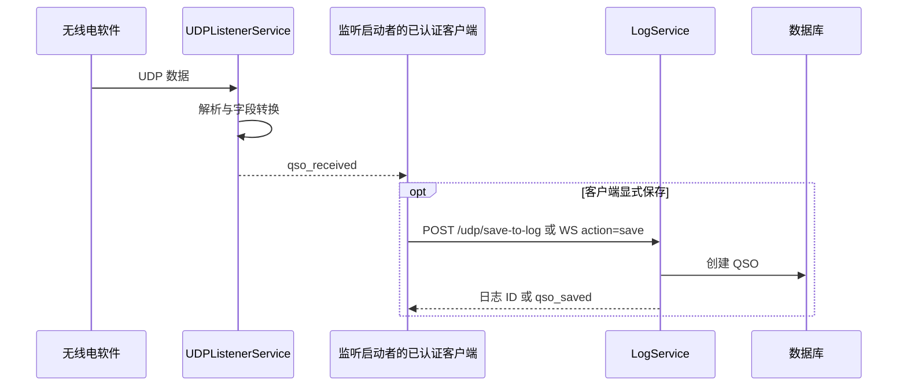

收到 UDP 广播后日志页只提示和刷新，不自动保存。默认绑定本机、拒绝白名单外来源；MySQL 模式的监听启停要求管理员，QSO 内容仅发送给启动者。
